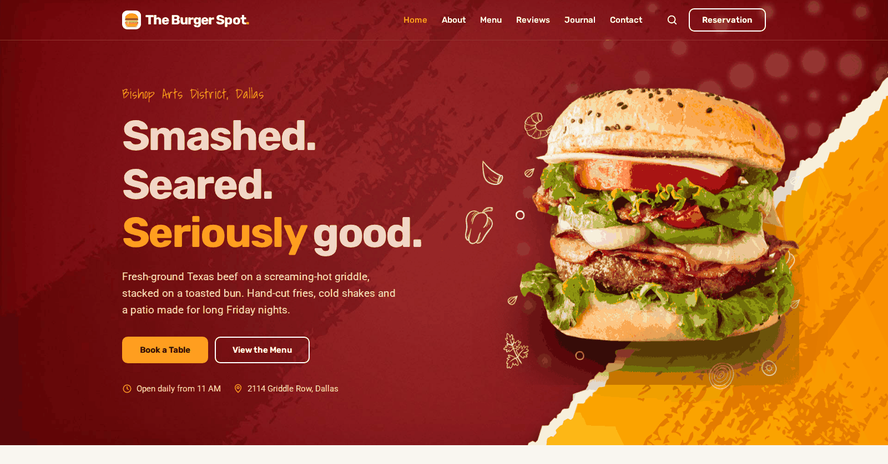

# The Burger Spot

A demo restaurant website built by [DFW Software Consulting](https://dfwsc.com) to show prospective restaurant clients what a polished, modern local-restaurant site can look like. The Burger Spot is a fictional Dallas burger restaurant; all names, addresses, phone numbers (555-01xx), reviews and prices are made up.

It started from the free "Foodie" template by codewithsadee and has been reworked: new content, a refreshed design system, a working menu filter and search, validated demo forms, and accessibility and performance fixes.

Live demo: https://dfw-software-consulting.github.io/burgerSpot/



## View locally

Plain HTML, CSS and JavaScript with no build step or dependencies. Open `index.html` in a browser, or serve the folder:

```sh
python3 -m http.server 8000
# then visit http://localhost:8000
```

All paths are relative, so it also works under the GitHub Pages `/burgerSpot/` subpath.

## Structure

- `index.html` - the single page
- `assets/css/style.css` - styles and design tokens (documented in `style-guide.md`)
- `assets/js/script.js` - nav, menu filter and search, demo forms and notices
- `assets/images/` - photos and illustrations

The page is marked `noindex` because the business is fictional. Forms and "Order Now" buttons are demos and send nothing.
